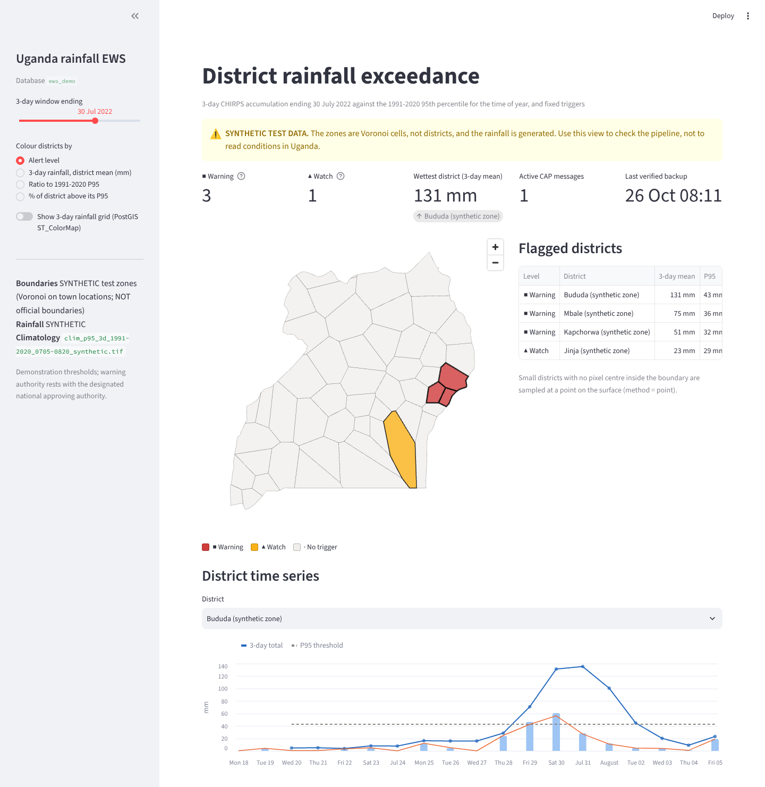

# Uganda rainfall early warning: PostGIS demo

A small, working version of the national hazard geodatabase described in the ICPAC / UNDRR
*National Early Warning and Data Officer (Uganda)* terms of reference. It ingests CHIRPS rainfall
and district boundaries into PostGIS, computes district rainfall statistics in SQL, flags
3-day accumulations above the 1991-2020 95th percentile (or a fixed trigger), records everything in
an operations log, exports a validated CAP 1.2 alert, and shows the result on a Streamlit map.
It ends with a one-page runbook for backup, integrity checks and re-ingest.

[](https://codespaces.new/rryesuafuga/postgis?quickstart=1)
Run it in the browser with nothing installed: see [Quick start](#in-the-browser-github-codespaces).

```
CHIRPS v2.0 daily GeoTIFF ─┐            ┌─ ref.district (GiST) ───────────┐
HDX COD-AB / GADM ─────────┼─ ogr2ogr ──┘                                 │  ST_Clip / ST_SummaryStatsAgg
                           │                                              ├──> ews.district_raster_stats
                           └─ raster2pgsql -t 100x100 -I -C ─ rain.* ─────┤    ews.district_exceedance ─> CAP 1.2 XML
CHIRPS 1991-2020 ─ xarray P95 of 3-day totals ─ rain.clim_p95_3d ─────────┘    ops.operations_log         ─> Streamlit map
```


*Screenshot from the **synthetic** offline fixture. The basemap is blank because the build sandbox
could not reach the tile server; the PostGIS layers draw regardless.*

## Contents

| Path | What it does |
|---|---|
| `.devcontainer/` | GitHub Codespaces: database + tools workspace, builds the demo and starts the app |
| `docker-compose.yml` | `db`: `postgis/postgis:16-3.4`. `tools` (optional): GDAL, PostGIS loaders, psql, Python |
| `sql/01_schema.sql` | schemas `ref`, `rain`, `ews`, `ops`; results, CAP and operations-log tables |
| `sql/02_seed_config.sql` | alert levels, trigger rules and the level to CAP urgency/severity/certainty mapping |
| `sql/10_districts.sql` | normalises the ogr2ogr staging table (auto-detects COD-AB / GADM columns) |
| `sql/11_rasters.sql` | registers raster2pgsql tables (date from file name, climatology catalogue) |
| `sql/20_analysis.sql` | **step 3/4**: zonal statistics, in-database 3-day accumulation, exceedance flags |
| `sql/90_integrity.sql` | `ops.integrity_checks()`: 20 checks used by the runbook and by backup verification |
| `sql/examples/adhoc_queries.sql` | the same logic written out step by step, plus `EXPLAIN` showing index use |
| `scripts/10_load_districts.sh` | **step 1**: `ogr2ogr` + explicit GiST index |
| `scripts/20_load_rasters.sh` | **step 2**: `raster2pgsql -t 100x100 -I -C` |
| `scripts/backup.sh`, `restore.sh`, `reingest_date.sh` | runbook procedures |
| `ews/` | Python: downloads, xarray climatology, orchestration, CAP builder and validator |
| `app/streamlit_app.py` | **step 7**: map, flagged districts, time series, CAP messages, ops log |
| `tests/` | CAP, climatology and downloader tests (downloaders run against local fakes of the real formats) |

## Quick start

### In the browser: GitHub Codespaces

Nothing to install. A codespace is a cloud computer with an editor in your browser; this
repository's `.devcontainer/` sets it up completely.

1. Click the **Open in GitHub Codespaces** badge above (or on the repository page: green
   **Code** button, **Codespaces** tab, **Create codespace on main**).
2. Wait about 5 minutes the first time. GitHub builds the database and the tools image, then loads
   the synthetic demo (`make demo`). The editor opens when that is done.
3. The app starts by itself in a terminal named **app** and opens in a preview tab. For a full
   browser tab, open the **Ports** panel, find port **8501**, and click the globe icon.

Notes:
* Reopening later: go to [github.com/codespaces](https://github.com/codespaces) and open the same
  codespace; the app starts again automatically. It stops by itself after 30 minutes idle.
* Stopped the app? In a terminal: `bash .devcontainer/start-app.sh`.
* Showing someone else: in **Ports**, right-click 8501, **Port Visibility**, **Public**, and send the
  link. It works only while your codespace is running.
* Real data in a codespace: stop the app (Ctrl+C in the **app** terminal), then
  `make init fetch load compute alert` and `bash .devcontainer/start-app.sh real`.
* Personal GitHub accounts include a free monthly Codespaces allowance (about 60 hours on the
  standard 2-core machine).

### A. Offline demo (synthetic data, about 15 s)

No downloads needed. It exercises every step, but the zones are Voronoi cells (not districts) and
the rain is generated. Everything synthetic is labelled as such, and CAP status is forced to `Test`.

```bash
cp .env.example .env
docker compose up -d db                 # PostGIS on localhost:5433
python3 -m venv .venv && . .venv/bin/activate && pip install -r requirements.txt
# also needs GDAL + PostGIS client tools on the host:
#   Ubuntu: sudo apt install gdal-bin postgis postgresql-client
#   macOS:  brew install gdal postgis libpq
make demo                               # separate database ews_demo and data/synthetic/
make demo-app                           # http://localhost:8501
```

No GDAL on the host? Run the same thing in the tools container:
`docker compose --profile tools run --rm tools make demo`, then
`docker compose --profile tools run --rm --service-ports tools make demo-app`.

### B. Real data

```bash
make up init
make fetch      # districts (HDX COD-AB), CHIRPS daily for the event window, 1991-2020 inputs, P95
make load       # ogr2ogr + raster2pgsql
make compute    # district statistics + exceedance flags
make alert      # CAP 1.2 for the most severe flagged district (status Exercise)
make integrity
make app
```

The event window defaults to 20 July - 5 August 2022, which brackets the 30-31 July 2022 Mbale
floods. Change `EWS_EVENT_START`/`EWS_EVENT_END` in `.env`. The climatology is built for the
event window plus or minus `EWS_CLIM_HALF_WINDOW` days, so rebuild it (`python -m ews fetch-climatology && python -m ews climatology`, then `make load`) when you move the window to another season.

Downloads: about 20 daily Africa GeoTIFFs from CHC (about 2 MB each, cropped to Uganda straight
away), and 30 small NetCDF subsets (about 3 MB per year) from NOAA ERDDAP's copy of the same CHIRPS
v2.0 product (`--source chc` downloads the daily files instead, about 1,500 files). CHIRPS final
data for a month are published around the third week of the following month.

## The steps

**1. Districts: `ogr2ogr` + GiST** (`scripts/10_load_districts.sh`)

```bash
ogr2ogr -f PostgreSQL PG:"host=... dbname=ews user=ews" /vsizip/data/boundaries/hdx/uga_admbnda_..._shp.zip/uga_admbnda_adm2_....shp \
  -nln ref.district_src -overwrite -nlt PROMOTE_TO_MULTI -t_srs EPSG:4326 -makevalid \
  -lco GEOMETRY_NAME=geom -lco SPATIAL_INDEX=NONE
```
```sql
SELECT ref.normalize_districts('OCHA COD-AB ...', 'OCHA-PCODE');   -- dissolve, repair, upsert by P-code
CREATE INDEX IF NOT EXISTS district_geom_gist ON ref.district USING gist (geom);
CLUSTER ref.district USING district_geom_gist;
```
`python -m ews fetch-districts` finds the admin-2 (district) layer of `cod-ab-uga` through the HDX
API. With `--source gadm` it takes the GADM 4.1 GeoPackage and picks the layer with 100-200
features. GADM is free for non-commercial use only; COD-AB is the humanitarian standard and carries
the P-codes used in the CAP `<geocode>`.

**2. Rasters: `raster2pgsql -t 100x100 -I -C`** (`scripts/20_load_rasters.sh`)

```bash
raster2pgsql -s 4326 -t 100x100 -P -I -C -M -F -d data/chirps/daily/*.tif rain.chirps_daily | psql
raster2pgsql -s 4326 -t 100x100 -P -I -C -M -F -d data/clim/clim_*.tif  rain.clim_p95_3d  | psql
```
`-I` builds the GiST index on `ST_ConvexHull(rast)` and `-C` adds the constraints (SRID, scale,
100x100 blocks, alignment, extent, nodata). A file on the wrong grid then *fails to load*, which the
re-ingest procedure relies on. `-P` pads edge tiles so every block is 100x100. `-F` keeps the file
name, from which `rain.register_daily_table()` derives `obs_date`. Every raster is first put on one
analysis grid (CHIRPS 0.05 degree cells, 29.4-35.2 E, 1.6 S-4.4 N), so CHIRPS subsets need no
resampling and tiles line up one-to-one.

**3. District mean and max: `ST_Clip` / `ST_SummaryStats`** (`ews.compute_district_stats`)

```sql
SELECT d.district_id, r.obs_date,
       ST_SummaryStatsAgg(ST_Clip(r.rast, 1, d.geom, true), 1, true) AS s   -- count, sum, mean, stddev, min, max
  FROM ref.district d
  JOIN rain.chirps_daily r ON r.obs_date BETWEEN $1 AND $2 AND ST_Intersects(r.rast, d.geom)
 GROUP BY d.district_id, r.obs_date;
```
A district can span several tiles. `ST_SummaryStatsAgg` combines the per-tile `ST_SummaryStats`
correctly (`sql/examples/adhoc_queries.sql` shows the explicit per-tile version and the weighted
mean). Districts too small to contain a pixel centre fall back to the pixel under
`ST_PointOnSurface` (`method = 'point'`). The results agree with an independent rasterio/numpy
computation to within 0.16 mm. Small differences come from boundary pixels: PostGIS and GDAL
disagree on one or two pixels in 7 of 50 zones.

**4. Exceedance** (`ews.compute_exceedance`)

* 3-day totals are built **in the database**: `ST_Union(rast, 'SUM')` over the three days per tile,
  masked with `ST_Union(rast, 'COUNT')` so a pixel missing on one day is not silently under-counted.
* The climatology raster (built with xarray, `ews/climatology.py`) holds, per pixel, the 95th
  percentile (band 1) and mean (band 2) of all 1991-2020 3-day totals ending within plus or minus 15
  days of the event dates. That gives the P95 for *this time of year*, not for all days of the year.
* Per district: mean and max 3-day total, mean P95, ratio, and the share of the district whose pixels
  exceed their own P95 (`ST_MapAlgebra` 1/0 raster, then clipped and averaged).
* Rules live in `ews.trigger_rule` (demonstration thresholds):

| rule | condition | level |
|---|---|---|
| `P95_MEAN` | district-mean 3-day total > district-mean P95, and at least 40 mm | watch |
| `P95_AREA50` | at least 50% of district pixels above their P95, and mean at least 50 mm | warning |
| `FIXED_MAX_100` | wettest pixel at least 100 mm in 3 days | watch |
| `FIXED_MEAN_80` | district-mean 3-day total at least 80 mm | warning |

  The absolute floors stop a statistically unusual but small total (35 mm in a dry zone) from
  raising a warning on its own. Operational thresholds are for UNMA and the national EW TWG to set.

**5. Results and operations log**: `ews.district_raster_stats`, `ews.district_exceedance` (with
`triggered_rules` and `alert_level`), the `ews.v_flagged` view, `ops.pipeline_run`, and
`ops.operations_log` (categories `STATUS INGEST PROCESS EXCEEDANCE ALERT FAULT ACTION ESCALATION
BACKUP INTEGRITY`). Every script and command writes to the log, and a trigger logs every CAP
message stored. `python -m ews report [--month YYYY-MM]` turns the month's log into an operations
report (`out/reports/`).

**6. CAP 1.2** (`python -m ews alert`, `ews/cap.py`)

```bash
python -m ews alert                                    # most severe flagged district, status Exercise
python -m ews alert --district $PCODE --status Draft   # template for the approving authority
python -m ews alert --district $PCODE --msg-type Update
python -m ews alert --district $PCODE --msg-type Cancel
python -m ews alert --district $PCODE --status Actual --approved-by "Name, Title"   # refused without approver
python -m ews validate-cap out/cap/*.xml              # make cap-xsd adds the official OASIS XSD
```

| level | severity | urgency | certainty | responseType |
|---|---|---|---|---|
| watch | Moderate | Future | Possible | Monitor |
| warning | Severe | Expected | Likely | Prepare |
| cancel | Minor | Past | Observed | AllClear |

The trigger is *observed* rainfall, but the hazard warned of (floods, landslides) is a likely
consequence, so certainty describes the impact. Targeting uses both `<polygon>` (district outline,
lat,lon order, closed, simplified to 100 or fewer vertices, slivers dropped) and `<geocode>` (OCHA
P-code). An `Update` or `Cancel` carries `<references>` to every earlier message of the incident
and the same `<incidents>` id. A second `Alert` for a district with an active one is refused.
`Draft` messages are templates and stay out of the lifecycle. The validator checks element order,
required fields, enumerations, CAP dateTime format (UTC written as `-00:00`), references, polygon
closure and ranges, and the official XSD when `schemas/CAP-v1.2.xsd` is present. A sample message
from the synthetic run is in `docs/sample-cap-test-synthetic.xml`.

**7. Map**: `make app`. District choropleth by alert level, 3-day total, ratio to P95 or % area
above P95, plus an optional 3-day rainfall grid mosaicked and colour-mapped **inside PostGIS**
(`ST_Union` → `ST_ColorMap` → `ST_AsPNG`), with time series, CAP messages, the ops log and live
integrity checks. It uses pydeck, which ships with Streamlit, so the district layers render even
without CDN or tile access.

**Optional layers.** GPM IMERG daily NetCDF (V07 `precipitation` or V06 `precipitationCal`, stored
`(time, lon, lat)` and transposed automatically) or an ICPAC seasonal-forecast GeoTIFF or NetCDF:

```bash
python -m ews prep-aux --input 3B-DAY.MS.MRG.3IMERG.20220730-S000000-E235959.V07B.nc4 --name imerg
python -m ews prep-aux --input icpac_ond2026_prob_above.tif --name icpac_ond2026 --date 2026-10-01 --units %
bash scripts/21_load_aux.sh imerg     # rain.aux_imerg + district stats; plotted against CHIRPS in the app
```

---

## Runbook (one page)

**Daily duty check**
1. `docker compose ps`: `ews-db` must be `healthy`. If not: `docker compose logs --tail 100 db`, then `docker compose restart db`, and log it.
2. `make status`: latest data date, failed runs and faults in the last 24 h, last verified backup, active alerts.
3. `make integrity`: any **FAIL** is a fault (below); **WARN** goes in the daily notes.
4. Review flagged districts (`make app` or `SELECT * FROM ews.v_flagged WHERE end_date = current_date - 1`), prepare `--status Draft` CAP messages for the approving authority, and issue only on their approval (`--approved-by`).

**Backup with verification** (daily after the run, and before any reload or upgrade): `make backup`
1. `pg_dump -Fc -Z 6 --no-owner -f backups/ews_<UTC>.dump`, then SHA-256 to `<file>.sha256`
2. `pg_restore --list <file>`: the archive table of contents is readable
3. Restore into scratch database `ews_verify`, compare row counts of the data tables with the live
   database, and run `ops.integrity_checks()` on the restored copy. Any difference or FAIL = failed backup.
4. Log `BACKUP` with `details.verified = true` (checked by `ops.backup.recent`). Keep the newest 7
   (`EWS_BACKUP_KEEP`). A dump that fails verification is renamed `*.failed` so it is never mistaken for a good one.
5. Copy `*.dump` and `*.sha256` off the server. Restore: `scripts/restore.sh <file> --yes` (checksum checked first).

Without host tools: `docker compose exec -T db pg_dump -U ews -Fc ews > backups/ews_manual.dump`.

**Integrity check**: `make integrity` (or `SELECT * FROM ops.integrity_checks();`)

| check | on FAIL |
|---|---|
| district count, valid geometry, SRID, overlaps | reload boundaries (`scripts/10_load_districts.sh`) |
| GiST indexes on districts and rasters | `CREATE INDEX ... USING gist (...)`, or reload with `-I` |
| raster constraints, alignment | reload with `-C` (`scripts/20_load_rasters.sh`) |
| missing dates, missing or duplicated tiles, values outside 0-500 mm/day | **re-ingest that day** |
| climatology present, aligned, covering the dates | rebuild climatology for the season |
| results and statistics cover every loaded date | `make compute` |
| CAP messages validated, references resolve | investigate before any further issuance |

**Re-ingest one day** (corrupt, missing or superseded file): `make reingest DATE=2022-07-30`
1. Logs `ACTION` "started", then re-downloads (`ARGS=--local` reuses the file on disk)
2. In **one transaction**: `DELETE` that day's tiles and `raster2pgsql -a` the new file. The `-C`
   constraints reject a mis-gridded file, the transaction rolls back, the old tiles stay, and a `FAULT` is logged.
3. Recomputes statistics for the day and the three 3-day windows that contain it (D to D+2)
4. Runs the integrity checks and logs `ACTION` "completed"

Full rebuild: `make load compute`. Everything is idempotent.

**Fault record and escalation**: classify as data source / service outage / database / dissemination, then record it:
```bash
python -m ews log FAULT chirps-feed ERROR "CHC 404 for 2022-07-30 (3 retries)"
python -m ews log ESCALATION chirps-feed WARN "Escalated to ICPAC" --details '{"symptoms": "...",
  "affected": "CHIRPS ingest", "diagnostics": "curl 404; ERDDAP OK", "impact": "3-day totals for 30 Jul-1 Aug delayed"}'
```

---

## What was tested

* `make demo` end to end on PostGIS 3.4.2 (Ubuntu 24.04) and on `postgis/postgis:16-3.4` (3.4.3),
  from the host and from inside the `tools` image over the compose network.
* Backup (dump, checksum, TOC, verification restore, row counts, integrity), including a simulated
  failure. Re-ingest of a good file, and rejection of a file shifted half a cell. Alert → Update →
  Cancel lifecycle and its refusals (duplicate Alert, Actual without approver, Actual on synthetic data).
* `pytest`: CAP builder and validator, climatology percentiles and gap handling, and the downloaders
  against local fakes of a CHC Africa `.tif.gz`, an ERDDAP NetCDF, an HDX package with a zipped
  COD-AB shapefile, a GADM GeoPackage and an IMERG `(time, lon, lat)` file.
* The dev container: with the dev container CLI (0.89, the engine behind Codespaces) on a fresh
  copy of the repository. The `tools` image was built from `docker/tools.Dockerfile` separately
  (this sandbox needs a proxy for pip), then `devcontainer up` ran `make demo` in the workspace
  container against the `db` service, and `start-app.sh` served the app on 8501, including
  rebuilding a missing demo database. Not yet opened in GitHub Codespaces itself.
* **Not yet run against the live CHC, ERDDAP, HDX and GADM servers.** The build sandbox could not
  reach them. URL patterns and formats follow the providers' published conventions. Check the first
  real `make fetch` and report any 404 with `python -m ews log FAULT ...`.
* Not tested against the official OASIS XSD (same reason). `make cap-xsd` downloads it, and
  `validate-cap` then applies it on top of the rule checks.

Found along the way: on the Ubuntu 24.04 PostGIS 3.4.2 package, `ST_Clip(rast, 2, geom)` on a
two-band raster crashed the backend. The query clips all bands once instead (3.4.3 is unaffected).
PostGIS also disables every GDAL output driver by default, so `01_schema.sql` enables PNG/GTiff
for the database (needed by `ST_AsPNG`). And `ST_ColorMap` entries must run from high to low: an
ascending table gives a blank image.

## How this maps to the ToR

| ToR | here |
|---|---|
| PostgreSQL/PostGIS: schema, spatial indexing, query performance | `sql/`, GiST on vectors and rasters, `EXPLAIN` in `sql/examples` |
| data loading, spatial query, indexing, integrity checks, backup verification, archive management | steps 1-4, `ops.integrity_checks()`, `scripts/backup.sh` with retention |
| CAP: structure, validation, urgency/severity/certainty, polygons and geocodes, updates and cancellations | `ews/cap.py`, `python -m ews alert/validate-cap` |
| operations log of status, alerts, faults and actions; monthly reports | `ops.operations_log`, `python -m ews report` |
| first-line fault diagnosis, structured escalation | runbook, `python -m ews log FAULT/ESCALATION` |
| gridded forecast data, satellite-derived hazard products, GDAL, Python | CHIRPS, IMERG/ICPAC loader, `ogr2ogr`/`raster2pgsql`, `ews/` |
| containers: inspect status, logs, restart | `docker compose ps/logs/restart`, `make status` |

## Data sources and licences

* **CHIRPS v2.0**: Funk et al. (2015), *Scientific Data* 2, 150066. UCSB Climate Hazards Center, public domain.
* **OCHA COD-AB Uganda** (HDX `cod-ab-uga`, UBOS): admin 2 = 135 districts. Licence as stated on HDX.
* **GADM 4.1**: free for academic and other non-commercial use.
* **Natural Earth** 1:50m admin-0 (public domain, via `world-atlas`, ISC): Uganda outline used only for the synthetic fixture.
* GPM IMERG (NASA GES DISC, Earthdata login) and ICPAC forecasts: supply the files yourself.

This is a demonstration, not an operational warning service. Thresholds, CAP sender, identifiers
and wording are placeholders for the national authorities to define.
